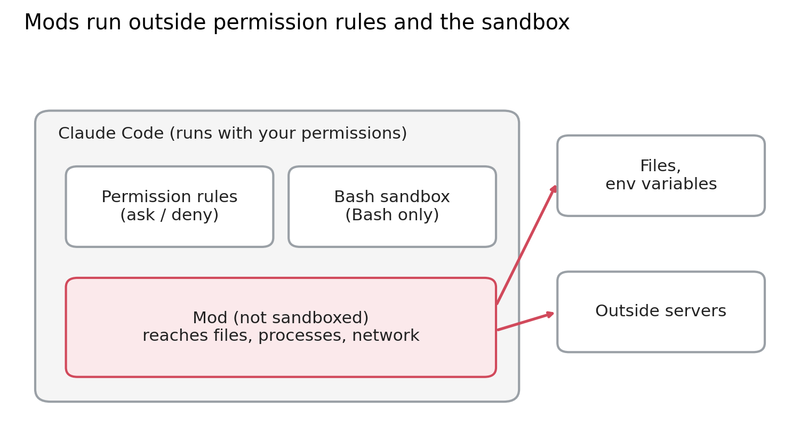
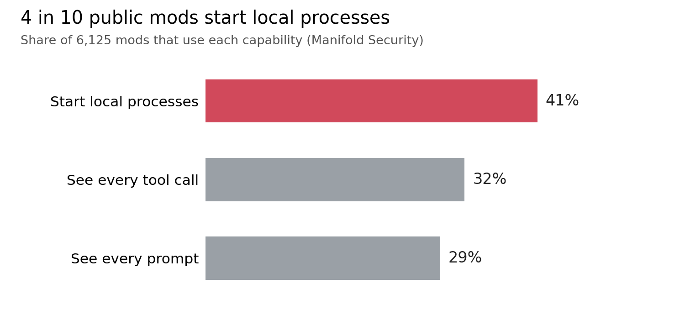

## Why I looked into this

On October 1, 2026, Claude Code got mods: small TypeScript functions that change how Claude Code behaves and what it draws. In this post, "mods" is the feature and "a mod" is one of them.

I had written one mod back in the early-access build (the function hooks you turned on with `CLAUDE_CODE_ENABLE_FUNCTION_HOOKS=1`). After a while with no input, it compacts once and has the summary include a note on where to pick the work up again. But my sessions sometimes hit an error and crashed right after startup, so I've stopped loading it until I find the cause.

Now that mods are generally available, I wanted to know what they can do and what to watch out for before turning mine back on. These are my notes.

Everything here is as of November 23, 2026. I read the official announcement, the docs, and the security write-ups cited later firsthand, not through summaries. Mods are less than two months old and still change often, so some of this may already be out of date.

## My setup

- Windows 11
- Claude Code v2.1.330
- Logged in with a personal Max plan. No managed settings (the settings file an organization deploys)
- Many hooks of my own that block risky actions, used with auto mode
- One mod I wrote (not loaded right now)

## What mods can do

The announcement calls mods "small TypeScript functions that change how Claude Code works." Claude Code calls a mod's functions at points like a tool call, a submitted prompt, or part of the screen being drawn, and the mod can watch, change, or take over what happens.

For example, a mod can:

- Open a pane beside the conversation or a band above the input box, with tabs, buttons, and input fields
- Redraw Claude Code's own UI, such as tool call rows, the spinner, or the question dialog
- Hold a tool call and ask you a question first, or return a result without running the tool
- Route a single Claude request to a different model
- Add a `/command` that runs your function right away, without going through Claude

Mods ship inside plugins. You list a JavaScript or TypeScript file under `modules` in `hooks/hooks.json`, and there's no build step. If you ask Claude, it will write the mod, install it, and reload it in your session.

Some of Claude Code's own features are already mods. They're listed under Built-in in the Installed tab of `/plugin`:

- `cc-plugin-agents-md`: loads AGENTS.md
- `cc-plugin-diff`: handles `/diff` in the terminal
- `cc-plugin-sec-default`: protects what your organization manages from mods that users install (can't be turned off)
- `cc-plugin-telemetry`: sends usage data
- `cc-plugin-you-should-know`: points out things you might have missed (off by default)

Mods are on by default from v2.1.287 in the terminal and from v2.1.286 in the desktop app.

## Mods run outside the sandbox, with your permissions



Of everything I read, this seemed the most important point. The announcement says: "They aren't sandboxed, and you should only install mods from sources you trust." The docs spell out what a loaded mod can do:

- Read and write files anywhere your account can, start programs, and make network requests
- Read API keys from environment variables and settings files
- See every prompt you send and every tool call Claude makes
- Rewrite prompts and tool calls, and submit a prompt as if you had typed it
- Approve a tool call before you are asked
- Call a model on your plan or API key

Claude Code's sandbox only isolates the Bash commands Claude runs. A process that a mod starts runs outside it.

Claude Code's existing hooks (shell commands and the like in a settings file, called "settings hooks" below) run in a separate process from Claude Code. A mod, on the other hand, is a function that Claude Code calls inside its own process. The comparison table in the docs puts it as "Functions in a plugin that Claude Code calls in its own process."

## On a personal plan, the built-in guard doesn't load

This was the part most relevant to my setup.

`cc-plugin-sec-default`, mentioned above, also limits some of what user-installed mods can do. But it only loads when one of these is true:

- The machine has managed settings (or a `managed-mcp.json`)
- You're logged in with `/login` on a Team or Enterprise plan

I'm on a personal Max plan with no managed settings, so the guard isn't loaded.

The permissions page of the docs describes what a mod can do in that setup:

- Approve a call that your PreToolUse hook blocked, and some calls that a deny rule refuses
- Skip the confirmation (permission prompt) from an ask rule or a PreToolUse hook
- In auto mode, a call the mod approves can run without the classifier check

I have a lot of settings hooks that block risky actions, and I use auto mode. Installing a single mod written by someone else would let it override what my settings hooks decide.

Even where the guard is loaded, the mod's own file and process calls (`$.fs`, `$.process`) can skip permission rules and PreToolUse hooks. The docs give the example that with `Read(.env)` denied, a mod can still read that file with `$.fs.read`.

There are exceptions. A mod can't change what the permission prompt shows. And for tools that need user interaction, such as AskUserQuestion, a mod's approval doesn't skip the confirmation (v2.1.292 and later).

## A broken mod is skipped silently

The troubleshooting page says:

> When a mod's module or one of its hooks fails, Claude Code skips it and the session continues, so a broken mod can look like one that does nothing.

- If a hook throws, times out, or returns a result of the wrong shape, that hook is skipped
- If the hooks worker (the background process that runs mods) stops three times and Claude Code can't trace it to one mod, every mod that isn't built in is turned off for that session, including mods your organization installed. `/reload-plugins` loads them again

So a mod meant to block risky actions blocks nothing if it's broken.

## `claude plugin validate` shows what a mod touches

I ran `claude plugin validate` on my own mod. It inspects the code without running it.

```text
❯ ./idle-compact-memo.ts hooks: turn.start, turn.complete, session.compact, session.end
❯ ./idle-compact-memo.ts gating hook without .catch: session.compact
❯ ./idle-compact-memo.ts calls: $.clock.after (via arm), $.clock.now (via arm, fire, writeMemo),
  $.fs.exists (via writeMemo), $.fs.write (via writeMemo), $.session.compact (via fire),
  $.session.cwd (via writeMemo), $.session.id (via arm, fire), $.ui.log (via log, notice)
```

According to the docs, the `hooks:` line lists the events the mod handles and the `calls:` line lists what it asks Claude Code to do. Mine writes files (`$.fs.write`) and triggers a compact (`$.session.compact`), and nothing in the list touches the network.

The docs also have a list of calls worth checking. For example, `$.fs.read` and `$.fs.write` read and write files anywhere, `$.env.get` reads environment variables that may hold API keys, and `$.model.complete` calls a model on your plan or API key. Before installing someone else's mod, I plan to compare its `hooks:` and `calls:` lines against that list. Since the check doesn't run the code, it can miss things, so I'll read the source too.

I also got a `gating hook without .catch` warning. As far as I can tell, it means a hook that blocks actions has no handling for its own failure. A failing hook gets skipped, so I'll add a `.catch` before turning the mod back on.

## The early-access environment variable no longer does anything

The docs say that if you set `CLAUDE_CODE_ENABLE_FUNCTION_HOOKS` during early access, you should remove it. From v2.1.287, Claude Code ignores it, so setting it to `0` doesn't turn mods off.

I had removed two environment variables to stop loading my mod: this one and the one pointing to my plugin's folder. Checking again, my mod is off because I removed the folder path, not because I removed `CLAUDE_CODE_ENABLE_FUNCTION_HOOKS`.

## 4 in 10 public mods start local processes



The security company Manifold Security looked at 6,125 mods published on GitHub. 41% start local processes, 32% see every tool call, and 29% see every prompt.

They analyzed the mods listed, as of October 25, 2026 (a little over three weeks after general availability), in the largest GitHub catalog of mods they could find. Other numbers from the post:

- 36% read environment variables and 35% read files. 13% can submit prompts as you, and 11% reach the network
- 267 mods (4%) hook the permission decision itself, and 93 of them can return "allow"
- About 20 let an outside channel, such as a Telegram bot or a relay server, submit prompts into a live session
- 223 mods from 63 repositories were already gone from GitHub. They may still be installed on people's machines, but nobody can check what's in them anymore
- At least 16 repositories read the Claude OAuth token. The ones they traced send it only to Anthropic

## Risky uses were shown before general availability

On September 22, 2026, Pluto Security used the early-access build (v2.1.274) to show that a mod could:

- Read `~/.claude/.credentials.json` and your prompt history and send them out
- Show "Hooks (0)" in `plugin details` even though it hooks every event
- Draw a fake API key prompt right above the input line
- Swap the question text in the AskUserQuestion dialog (Claude Code restores the option labels, but generic ones like "Confirm" and "Cancel" look the same either way)
- Make the command that actually runs differ from the one shown in the transcript
- Fetch and run remote code after you install it

They also confirmed that mod code runs where `fetch` and `require` aren't directly available, and that a mod can't rewrite the tool-approval prompt. The post notes that it covers the pre-release implementation and that things may change. I haven't checked whether the same things work in the released version.

## Other plugin security issues beyond mods

- **Plugin4Shell** (published by AIR Security on September 17, 2026, CVE-2026-86063): even when a marketplace pins a plugin to a commit SHA, an attacker can create a branch with the same name as that SHA, and git checks out the branch instead. It reportedly reaches users with no action on their part, through plugin auto-update. It affected Codex, Copilot, and Gemini CLI as well as Claude Code, and Claude Code is fixed in 2.1.179 and later
- **HOOKPRY** (arXiv, not peer reviewed, submitted September 3, 2026): research on quietly slipping an attacker's commands into a harmless plugin as hooks in a later update. Across 1,000 runs on seven agent harnesses, it compromised all seven, with success rates of up to 92.5% per harness. Microsoft Defender reportedly flagged none of the attacks
- **Cursor's marketplace**: for about 11 hours on October 29, 2026, Cursor's extension marketplace served a tampered Claude Code extension (2.1.312 and 2.1.313, for Windows and macOS). It tried to set up an SSH backdoor. On most machines that step fails, because enabling SSH needs admin rights the extension doesn't have. Still, it added the attacker's SSH key, installed persistence, and sent host details. Cursor says the versions were not made by Anthropic and that it has no evidence the official distribution was affected

The plugin security page in the docs also notes that when auto-update is on for a marketplace, files you reviewed can change on disk later. By default, auto-update is on for Anthropic's official marketplaces such as `claude-plugins-official` and for marketplaces added from claude.ai, and off for all others (including the official `knowledge-work-plugins` and `first-party-plugins`).

## How I'm going to use mods

- Install only mods I wrote and the built-in ones. The guard doesn't load on my machine, so I'll assume someone else's mod can get around my hooks
- If I want to try someone else's mod, check its `hooks:` and `calls:` lines with `validate` and read the source before installing. No large packs bundling many mods
- Keep auto-update off for marketplaces other than the official ones
- Add a `.catch` to my mod and turn it back on only after I find why sessions crashed at startup

For work use, I'm also noting the managed settings that restrict mods:

- `allowManagedModsOnly` (under `cc-plugin-sec-default@builtin` in `pluginConfigs`): refuses mods that users install themselves. Users' settings hooks and status lines keep working
- `allowManagedHooksOnly`: loads only your organization's mods and the built-in ones. Users' own settings hooks stop too
- `disableAllHooks`: stops every mod and hook except the built-in mods, including your organization's. PreToolUse hooks in managed settings stop as well
- `disableSideloadFlags`: rejects `--plugin-dir` and similar flags at startup, and keeps mods Claude writes during a session from loading
- `prependPlugins`: runs your organization's mods first. When it's used, `sec-default@builtin` has to be in the list too, or the built-in guard is removed
- `strictKnownMarketplaces`: an allowlist of marketplaces users may install from
- `DISABLE_AUTOUPDATER` (in the managed `env` block): turns off plugin auto-update. It also stops Claude Code's own updates. To keep plugin auto-update, add `FORCE_AUTOUPDATE_PLUGINS`

## Sources

- [Announcement (October 1, 2026)](https://claude.com/resources/articles/claude-code-mods)
- Mods docs: [overview](https://code.claude.com/docs/en/plugins/mods/overview), [admin](https://code.claude.com/docs/en/plugins/mods/admin), [troubleshoot](https://code.claude.com/docs/en/plugins/mods/troubleshoot)
- [Plugin security](https://code.claude.com/docs/en/plugins/security), [plugin auto-update](https://code.claude.com/docs/en/plugins/loading), [plugins for organizations](https://code.claude.com/docs/en/plugins/org)
- [Permissions: precedence among rules, hooks, and mods](https://code.claude.com/docs/en/permissions)
- [Manifold Security](https://www.manifold.security/blog/agent-add-ons-approval-claude-code-mods)
- [Pluto Security](https://pluto.security/blog/claude-code-function-hooks-security/)
- [AIR Security: Plugin4Shell](https://www.air.security/blog-posts/plugin4shell)
- [HOOKPRY (arXiv)](https://arxiv.org/abs/2609.03884)
- [Cursor security notice](https://cursor.com/blog/claude-code-extension-security-notice)
- Japanese version: [Qiita](https://qiita.com/ussu_ussu_ussu/items/d2416096c85ab0d4a13a)
