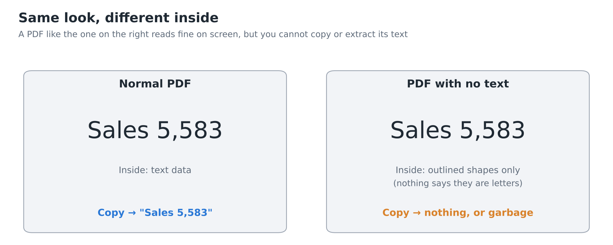
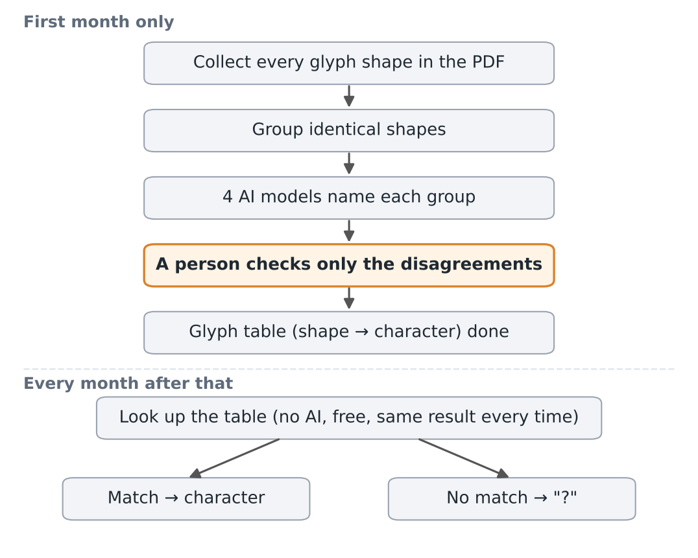
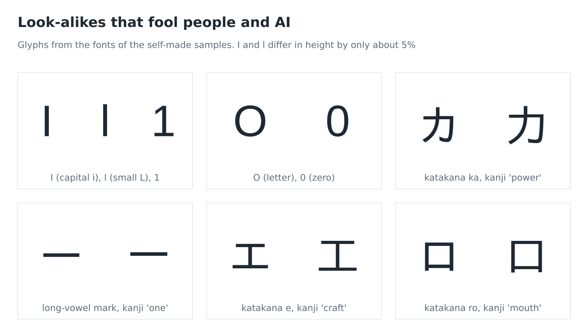
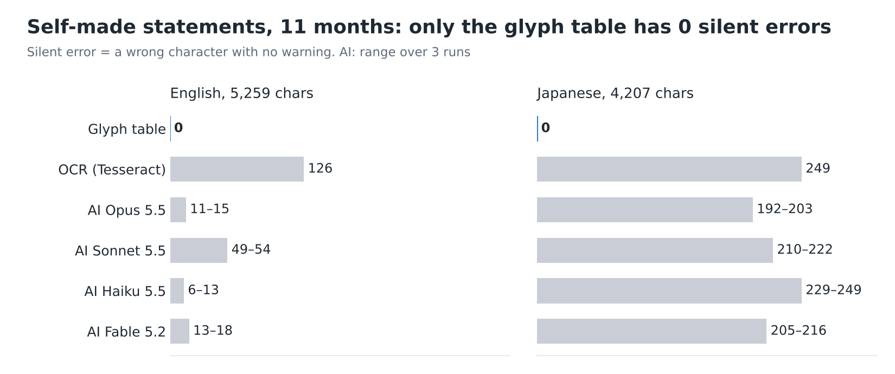
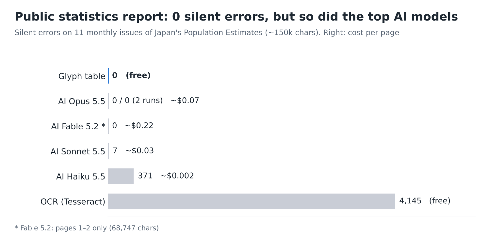
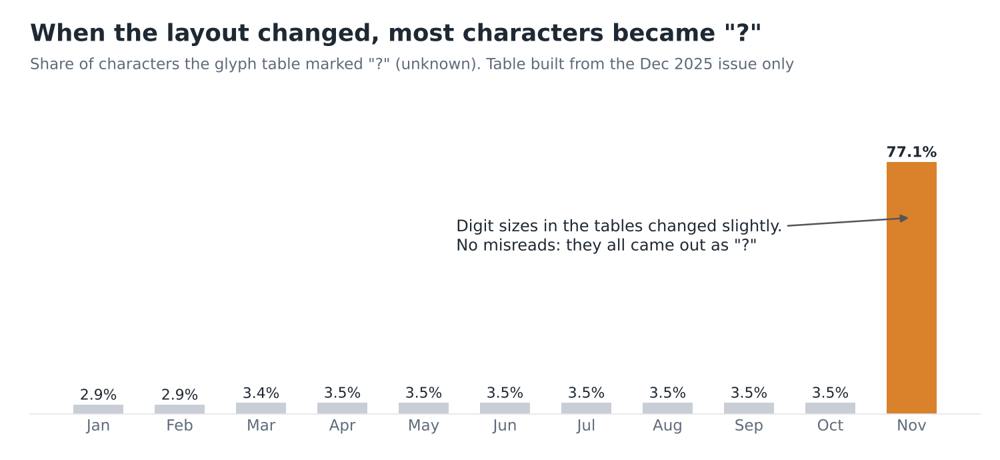
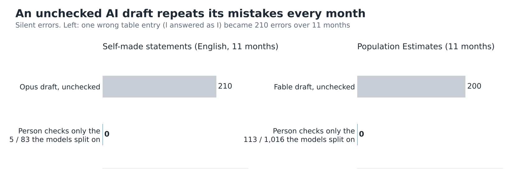

When I analyze statistics as a hobby, the source numbers are often published only as PDFs from government offices: monthly reports that come out in the same layout every month. With a normal PDF, you can copy the numbers and paste them into a spreadsheet. But some PDFs read fine on screen and give you a string of symbols when you copy, or don't let you select any text at all.

They look the same, but the inside is different. A normal PDF contains data saying "the character 'S' is here." A PDF with no extractable text only says "a shape made of these lines is here"; the PDF itself does not know which character it is.

To read such a PDF, you usually render the page as an image and run it through OCR, or these days hand it to an AI model. But paying for AI every time you read a monthly report, and getting slightly different results each time, is a poor fit for hobby analysis.

This kind of PDF has one useful property: **the same character is drawn with exactly the same shape every time**. Unlike handwriting, a "5" is always the same "5". So if you build a table that says "this shape is 5" once, you should be able to read every later issue just by looking shapes up. I call this table the glyph table.

I built this method and compared it with OCR and with AI (four Claude models from Anthropic) under the same conditions. For test data I used samples I made myself and public data anyone may use (the monthly report "Population Estimates" from the Statistics Bureau of Japan).

Everything I built and every result is public: [document-extraction-lab](https://github.com/yasumorishima/document-extraction-lab) (`topics/glyph-table/`).

## Build the table from the first month only; after that, just look shapes up

From the first month's PDF, collect every glyph shape. Put identical shapes into one group and decide which character each group is; that gives you the glyph table. AI models answer which character each group is, and a person checks only the groups where the models disagree (more on this below).

From the second month on, you only look shapes up in the table. No AI is used, so it costs nothing, nothing goes over the internet, and the same PDF always gives the same result.

The rule I cared about most: **never make up a character it does not know**. A shape that is not close enough to any shape in the table is not forced into a match; it comes out as "?". When different characters with similar shapes end up in the same group, that group also comes out as "?". A person who looks will notice a "?", but nobody notices a plausible wrong character.

## I mixed in look-alike characters on purpose, the kind that fool people and AI

First I made 12 months of fictional monthly statements myself. The item-code column deliberately mixes look-alikes: capital I, small l and 1; O and 0; and in Japanese, katakana カ (ka) and the kanji 力 (power), the long-vowel mark ー and the kanji 一 (one), and so on. In the English font I used, I and l differ in height by only about 5%.

I made the same statements 17 ways: different fonts, Japanese text, ruled lines, tighter letter spacing, and so on. I built the table from January alone and read February to December.

What I counted is the **silent error**: a character read as a different one with no warning. A "?" does not count as an error.

## Only the glyph table had 0 silent errors over 11 months

The glyph table had 0 silent errors in both English (5,259 characters) and Japanese (4,207 characters). In 16 of the 17 conditions it stayed at 0 for all 11 months.

OCR made 126 errors in English, reading O as 0 and I or l as 1, among others. In one month the amount "5,583" became "5,983". In Japanese it made 249 errors, 12 of them in digits, such as reading 0 as 9.

I told the AI models: "watch out for look-alikes, and you may write ? for a character you are not sure of." Even so, all four confidently picked between I and l, or between カ and 力, and got them wrong. Opus 5.5 made 11 to 15 errors in English; in Japanese every model made more than 190. When I had each model read the same page 3 times, only 0 to 2 of 11 pages came out the same all 3 times. The answer changes from read to read.

On the other hand, with a font where I and l look clearly different, the AI (Opus 5.5) also made 0 errors. What AI struggles with are strings like item codes, where the surrounding text gives no hint of what the character probably is.

The only errors the glyph table made, 25 characters, were in a condition built so that glyph shapes drift slightly on purpose. But in that condition, building the table already shows that "the same character does not have a consistent shape". In other words, **you know the PDF is risky before you read it**.

## On a public statistics report: 0 silent errors, but the top AI models also had 0

Testing only on samples I made myself could turn into a test that suits me. So I also tested on a real document: 12 monthly issues of the Statistics Bureau of Japan's "Population Estimates". It is packed with small-print tables mixing kanji, Latin letters and digits.

These PDFs are actually normal PDFs you can copy from. So I made versions with the text information removed, leaving "only the shapes", and checked the results against the original text as the answer key. I built the table from the December issue alone and read the January to November issues of the following year, about 150,000 characters.

The glyph table had 0 silent errors here too. OCR made 4,145 errors, such as reading 人 (person) as "A", ＋ as 十 (ten), and 月 (month) as "4".

To be honest, **the top AI models (Opus 5.5 and Fable 5.2) also made 0 errors on this report**. On an ordinary government document without confusing item codes, the glyph table does not win on accuracy.

The difference is elsewhere:

- **Cost**: Opus 5.5 costs about $0.07 for every page it reads, about $690 a month for 10,000 pages. The glyph table uses AI only once, when the table is built
- **Same result every time**: the glyph table always gives the same result for the same PDF
- **Whether the document leaves your machine**: the glyph table reads entirely on your own computer

## In the month the layout changed, it said "?" instead of misreading

In the January to October issues, about 3% of characters came out as "?", mostly characters that never appeared in the December issue the table was built from.

In the November issue this jumped to 77%. Looking into it, the size of the digits in the tables had changed slightly. Those sizes were not in the table, so the glyph table **marked every November digit as "?" instead of misreading it**. Once a person checks the new digit sizes and adds them to the table, it reads the following months again.

As someone who uses the data, I would much rather be told "I don't know" than be given a silent error.

## An AI-drafted table repeats the same mistake every month unless it is checked

I also let AI decide "which character is this group" when building the table. Each group's representative glyph is shown inside the line where it was printed, with a red box around it, and the model answers which character it is.

For the 1,016 groups of the Population Estimates, Fable 5.2 answered 1,000 correctly. That is very good, but using that table without a check still gave 200 silent errors over 11 months. On the self-made statements, a single wrong entry (l answered as I) grew into 210 errors over 11 months. A wrong table repeats the same mistake every month.

Checking everything by hand is a lot of work, though. So I **had four AI models answer independently, and a person looks only at the groups where their answers split**. On the self-made statements, the person had to look at only 5 of 83 groups in English and 7 of 90 in Japanese, and every group where the majority vote was wrong was among them. On the Population Estimates, the person looks at 113 of 1,016 groups (about 1 in 10), and the corrected table had 0 silent errors.

The key is to **mix different kinds of AI models**. When I had the same model answer 3 times, it repeated the same mistake 3 times, so the answers never split and the mistake went unnoticed.

There was one place, though, where all four models made the same mistake (i answered as j). That character happened not to appear in later months, so it just didn't affect the results.

## Tilted pages are straightened before reading; strongly tilted ones go to a person

When a page is rotated, the glyph orientations no longer match the table. When I tried reading pages turned upside down, silent errors appeared: n and u, and 6 and 9, turn into each other's exact shapes when flipped.

So before reading, the method measures the page's tilt and orientation and straightens it. In addition, pages where more than 30% of characters are "?", and pages tilted by more than 10°, are not read at all and go to a person as a whole.

I tested this **after deciding and publishing "what counts as a pass" before running anything**, so the criteria could not be changed afterwards to suit the results. Rounds 1 and 2 partly failed; round 3 finally passed everything. On the Population Estimates, all 66 tilted or rotated pages had their orientation and tilt corrected. The records of the failed rounds are kept as they are.

## Summary

Within what I tested:

- Using the fact that "the same character is the same shape", PDFs with no extractable text can be read for free with the same result every time. Unknown characters come out as "?", and there were 0 silent errors on 16 self-made conditions and on the public statistics report
- AI is better used once, to draft the table, than to read every page. Comparing the answers of different kinds of AI models cut what a person has to check to about 1 in 10
- On documents with few look-alikes, the top AI models are accurate enough too. The choice comes down not only to accuracy but to cost, whether the result is the same every time, and whether the document leaves your machine

I hope this helps anyone who collects statistics published in the same layout every month.

## Appendix

### Terms

- **Glyph table**: a table of glyph-shape groups → characters
- **Silent error**: a character different from the correct one, output with no warning
- **"?"**: a character not close enough to any shape in the table, or one in a confusable group. Not counted as an error
- **OCR**: software that reads characters from a page image. Here OCRmyPDF 17.4.0 + Tesseract 5.3.4

### How it works (for engineers)

- Reads the filled shapes in the PDF (handles `q`/`Q`/`cm`) and drops long thin rectangles as ruled lines
- Renders each glyph as a small black-and-white bitmap and measures similarity by overlap. If the width or height differs by more than a tolerance, it is a different character. Positions shifted by 1 pixel are also tried
- The similarity threshold is set from the first month alone. If "the lowest similarity between same characters" is higher than "the highest similarity between different characters", the midpoint is used
- Python standard library only. Reading takes 0.3–1.5 s per page (self-made statements) and about 10 s (dense tables of the Population Estimates)
- Tilt is the median angle of the lines joining nearby glyphs of the same size

### Conditions and caveats

- Everything ran in the Claude Code cloud environment (x86_64)
- The 17 self-made conditions: 4 fonts (Liberation Sans, Serif and Mono, DejaVu Serif), Japanese (IPAGothic), text turned into shapes by Ghostscript, each line merged into one shape, ruled lines touching glyphs, tight letter spacing, quotation marks, and 3 levels of coordinate jitter (±0.02 / ±0.05 / ±0.1 pt). Only the ±0.1 pt condition had errors
- Population Estimates: pages 1–5 of the December 2025 to November 2026 issues (153,247 characters). Text was turned into shapes with Ghostscript 10.02.1 `-dNoOutputFonts`, and the original text was used as the answer key. These are not PDFs that were made of shapes to begin with. In the November issue the table digits changed from 7.5 pt to 7.14 pt and from 7.92 pt to 7.8 pt
- I have not measured how much glyph shapes drift in real-world PDFs
- The human check was simulated with the answer key. The real effort of a person checking 113 groups, and human misreads, were not measured
- AI: only the four Claude models (Opus 5.5, Sonnet 5.5, Haiku 5.5, Fable 5.2); OCR: only Tesseract. The models saw 150 dpi page images with an instruction to watch for look-alikes. Costs are at list price
- For all 3 rounds of the tilt and orientation work, the pass criteria were committed to the repository before testing (pre-registration). The angles used for judging were 0.3°, -4°, 9°, 95°, 25° and -60°
- Vertical writing: one self-made condition only (0 errors, same as horizontal). Text in images embedded in the PDF is out of scope

### Data source

Created by processing "Population Estimates" (Statistics Bureau of Japan) (https://www.stat.go.jp/data/jinsui/new.html), under the Public Data License (Version 1.0). Because the PDFs include font rights, the repository does not contain the PDFs; it holds only the download and conversion scripts and the reading results.

- Japanese version: [Zenn](https://zenn.dev/shogaku/articles/glyph-table-pdf-ocr), [Qiita](https://qiita.com/ussu_ussu_ussu/items/ad5c68cb730a2e655f85)
